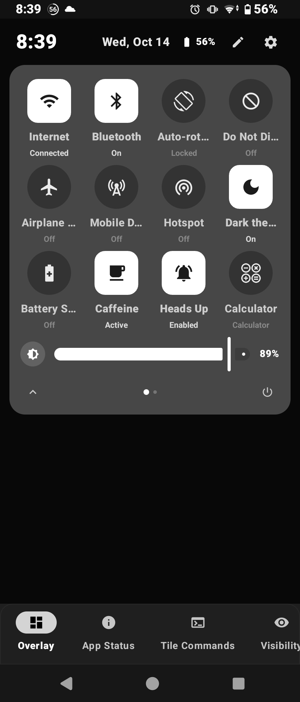
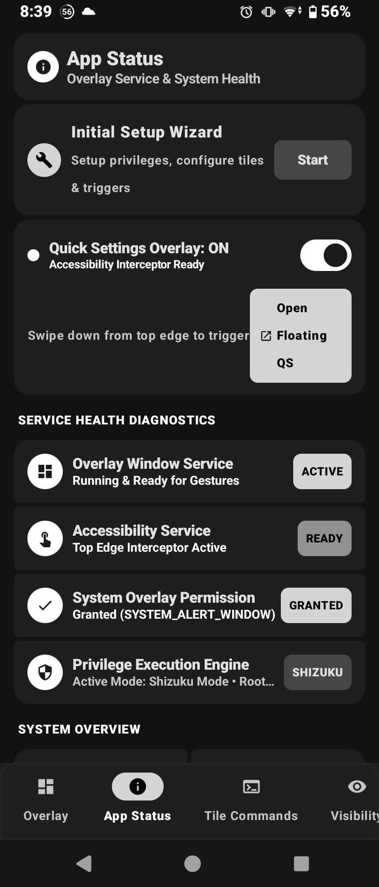
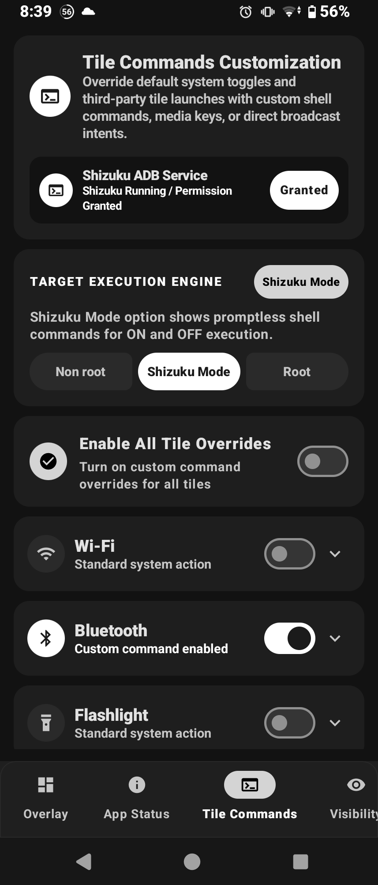

# ⚡ QuickSettings (v2.5.0)
**A modern, highly customizable Material 3 Control Center & Notification Shade replacement for Android.**

*Personalize tile shapes, custom status bar triggers, brightness sliders, notification overlays, shell command overrides, and gesture controls with fluid Material 3 design.*

## 📷 Screenshots

---

## ✨ Key Highlights

* 🎨 **Authentic Material 3 Design**: Sleek dark/light UI with dynamic styling, custom vector SVG/XML tile shapes, squircles, and outlines.
* 🛡️ **Multi-Mode Execution Engine**: Works seamlessly across **Non-Root (Standard API)**, **Shizuku Mode (Elevated ADB)**, and **Root (Full Control / SU)**.
* ⚡ **Custom Tile Commands**: Override any system toggle (Wi-Fi, Bluetooth, Flashlight, etc.) with custom ON/OFF shell commands, media keys, or broadcast intents.
* 🔔 **Lightweight Heads-Up & Notification Hub**: Custom top notification banner overlays with gesture routing, plus a real-time ongoing notification interceptor and package/channel blacklisting.
* 🎯 **Smart Shade Interception**: Automatically intercepts and collapses the native stock Android shade (Android 12–15+) and replaces it instantaneously with QuickSettings.
* 🚀 **Prime Core Smoothness**: Optional CPU thread affinity pinning to the prime core (Root) and instant no-animation toggles to completely eliminate micro-stutters.

---

## 🛠️ Feature Breakdown

### 1. 🎛️ Control Center & Quick Settings Design
Customize every visual aspect of both the compact **Quick Quick Settings (QQS)** header and the expanded **Quick Settings (QS)** panel:
* **QQS Icon Sizing & Quantity**: Adjust circular icon sizes (`32dp` – `64dp`, default `48dp`/`52dp`) and set the number of toggles in the collapsed row (`2` to `6` icons).
* **Custom Vector Tile Shapes**: Choose distinct shapes for **Enabled (Active/ON)** and **Disabled (Inactive/OFF)** states (*Circle, Squircle, Square*, etc.), or import your own custom **SVG / Vector XML Path Data** (`100x100` viewport preview) via clipboard or file picker.
* **Tile Outlines**: Enable a `1.2dp` stroke outline on tiles with the inner background hidden.
* **Carrier & Header Details**: Show dynamic SIM card network operator names, toggle the divider line between carrier and QQS tiles, and customize the **Date Position** (*Next to Time, Below Time, Header Right*) and **Edit Pencil Icon Location** (*Footer Only, Header Only, Header & Footer*).
* **Brightness Slider & Progress Bar Styles**:
  * Move the brightness slider to the bottom of the QS panel or force it to always show inside the compact QQS view.
  * Choose between **M3 Slider**, **Sleek Straight Bar**, or **Android 13/14 Animated Wavy Track** for media players and brightness controls.
* **Grid Density & Drag Handle**: Configure expanded grid dimensions (`3x3`, `4x1`, `4x2`, `4x3`, `4x4`), adjust the expansion drag pill length (`20dp` – `80dp`), or hide the QQS drag handle completely.

---

### 2. ⚙️ Execution Privileges & Custom Tile Commands
QuickSettings adapts dynamically to your device's privilege level:
* **Non-Root (Safe / Default)**: Uses Accessibility Service, `WRITE_SETTINGS`, and native System Settings dialog fallbacks.
* **Shizuku Mode (Elevated ADB)**: Executes promptless elevated ADB/System shell commands via the Shizuku IPC service.
* **Root (Full Control)**: Direct `su` shell execution for immediate hardware toggles without confirmation dialogs.

#### 🖥️ Per-Tile Command Overrides & Console
Override default system actions for individual tiles (e.g., Wi-Fi, Bluetooth, Flashlight):
* **Behavioral Modifiers**:
  * *Close panel on press*: Dismisses the overlay immediately after clicking the tile.
  * *Force state change anyway*: Instantly flips the visual state locally on tap.
  * *Block state changing*: Freezes the current state and ignores clicks.
  * *Always Active*: Permanently locks the tile visual state to `ACTIVE`.
* **Custom Shell Commands**: Define custom ON and OFF shell commands per tile (e.g., `cmd bluetooth_manager enable` / `cmd bluetooth_manager disable`) with built-in **Test ON**, **Test OFF**, and **Reset** buttons.
* **Dynamic Command Execution Console**: Built-in terminal runner inside the *Privileges* tab to test shell commands (e.g., `svc wifi enable`) directly against the active engine.

---

### 3. 👁️ Tile Visibility & Smart Blacklist
Keep your control center clean and relevant:
* **Compatibility Auto-Hide**: One-tap **Smart Hide Unsupported Tiles** automatically hides toggles that aren't supported in your current operational mode (e.g., Elevated ADB vs. Standard API).
* **Granular Search & Toggle**: Search through all 39+ system tiles, view their privilege requirements (`Standard API` vs. `Requires ADB/Root`), and toggle visibility on the fly.

---

### 4. 🔔 Heads-Up Overlays & Notification Hub
Take full control of how alerts and persistent notifications behave:
* **Custom Heads-Up Overlay**: Lightweight Compose top overlay inflated via `WindowManager` for high-priority notifications.
  * **Interactive Testing**: Built-in *Test Alert*, *Test Alarm*, and *Test Incoming Call* triggers.
  * **Auto-Dismiss Timeout**: Adjustable banner duration from `2s` to `10s` (default `4s`).
  * **Gesture Actions**:
    * *Swipe Up / Left / Right*: Dismiss heads-up banner.
    * *Swipe Down*: Directly trigger the Custom Quick Settings Shade.
    * *Tap*: Open the notification destination app.
* **Notification Hub & Blacklist**:
  * Analyzes ongoing and persistent notifications in real-time.
  * **Hide / Unhide** noisy persistent cards (e.g., *Battery Guru*, *Android System* overlay alerts) and manage package/channel blacklist rules.

---

### 5. 🎯 Triggers, Gestures & Performance
Engineered to feel like a native part of SystemUI:
* **Status Bar Trigger & Auto-Override**:
  * **Invisible Status Bar Trigger**: Keep top-edge swipe gestures active while making the trigger strip completely invisible.
  * **Use Auto System Panel Closing (A12–A15)**: Actively forces the stock Android 12–15 notification shade to collapse when opening the custom panel.
  * **Stock Shade Auto-Override**: Automatically intercepts native SystemUI shade expansions and substitutes them with QuickSettings.
  * **Fine-Tuned Timing**: Configure **Panel Replacement Delay** (`0ms Instant` up to `1000ms`) and **Detector Cooldown** (`10ms` to `1000ms`, default `280ms`).
  * **Whitelist & Blacklist Detection**: Define target whitelisted SystemUI packages (`com.android.systemui`, `com.google.android.systemui`, etc.) and reject unwanted package/class events.
* **Hardware Gestures**:
  * **Hide QS/QQS on Volume Key Press**: Automatically closes the Quick Settings panel when pressing hardware volume buttons.
* **Performance & Debug**:
  * **Disable Panel Animations**: Open, close, and expand Quick Settings instantaneously with zero transition delay.
  * **Prime Core High Smoothness Mode (Root)**: Pins CPU thread affinity to the prime core to eliminate swipe and scrolling micro-stutters.
  * **Debug Placeholder**: Force the Media Player card to remain visible with preview track data even when no music is playing.

---

## 🔒 Required Permissions Checklist

To provide a seamless system-level experience, QuickSettings utilizes the following permissions (configurable via the **Initial Setup Wizard** or **App Status / Privileges** tabs):

| Permission / Service | Purpose |
| :--- | :--- |
| **Draw Over Other Apps** (`SYSTEM_ALERT_WINDOW`) | Renders the custom Quick Settings overlay, floating triggers, and custom Heads-Up banners. |
| **QuickPanel Accessibility Service** | Enables top-edge gesture interception, global shade expansion, and automatic stock shade closing. |
| **Modify System Settings** (`WRITE_SETTINGS`) | Allows direct control over screen brightness, auto-rotation, and system parameters. |
| **Notification Policy Access** (`ACCESS_NOTIFICATION_POLICY`) | Required to toggle Do Not Disturb (DND) modes. |
| **Notification Access** (`NotificationListenerService`) | Powers the Notification Hub, ongoing card hiding, media player integration, and custom Heads-Up alerts. |
| **Shizuku / Root Access** *(Optional)* | Unlocks silent hardware toggles (Wi-Fi, Mobile Data, Hotspot, Airplane Mode, etc.) and custom shell execution. |

---

## 👨‍💻 Developer & Community

* **Creator & Lead Developer**: Maxim Tarna
* **Package Name**: `com.fauyds.quicksettings`
* **Telegram Channel**: [t.me/allphonecustomization](https://t.me/allphonecustomization) — *Join our community for custom themes, SVG shapes, setup guides, exclusive updates, and feedback!*
